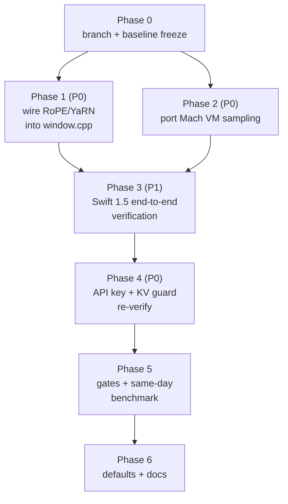

# Strata v0.2.2 M5 Max Implementation Plan — Swift 1.5, RoPE and YaRN Fully Functional on 128 GB

**Target Hardware:** Apple Silicon Mac (M5 Max, 128 GB Unified Memory; the machine reports 137.4 GB to the OS)
**Operating System:** macOS 27 (Golden Gate)
**Base:** upstream `v0.2.2` (`011c9e60`, engine 0.1.47), cloned at `Strata-0.2.2/`
**Companion:** [v0.2.2-m5-migration-report.md](v0.2.2-m5-migration-report.md) (verified patch inventory; this plan executes it)

Goal: on the v0.2.2 branch, Swift 1.5 (`qwen4exp`) runs end-to-end on Metal with RoPE/YaRN scaling active for
long context, with every gate green on the M5 Max. Per [AGENTS.md](../AGENTS.md): one change per PR, the default
path byte-identical to the last release, every file touched built for every backend it belongs to.



Phases 1 and 2 touch disjoint files and can run in parallel. Phases 3–6 need both.

---

## Phase 0 — Branch and Baseline Freeze

1. `git checkout -b v0.2.2-m5 v0.2.2` in the clone.
2. Freeze the baseline on the M5 Max (same day as the final gate run):
   - `python3 tools/strata_bench.py --url http://127.0.0.1:8080 --prompt "Explain quantum mechanics in 50 words." --tokens 100 --runs 5`
   - `python3 tools/strata_bench.py --url http://127.0.0.1:8080 --prefill-tokens 8192 --tokens 10 --runs 3`
   - Run against the current v0.2.1-m5 build; record both numbers in the PR.
3. Confirm the frozen arena test still passes untouched: `arena_budget_test` (137.4 GB / 115.4 GB / 97.7 GB freeze).

---

## Phase 1 — Wire RoPE / YaRN into the Metal Window (the core change)

**Why:** upstream 0.2.2 (and, as verified, the current v0.2.1-m5 tree) builds the decode window's cos/sin table
with a fixed unscaled loop. The scaling machinery exists and is tested — `include/strata/kernels/rope_scaling.hpp`
(YaRN ramp, linear, mscale) and `metal/src/engine/rope_table.h` (`build_rope_table_interleaved`, present only in
the old tree) — but **no engine code calls the interleaved builder; only the parity test does**. Without the call
site, contexts past 32,768 tokens degrade on YaRN/linear configs.

**Changes (one PR):**

1. **Port `metal/src/engine/rope_table.h`** from the v0.2.1-m5 tree (fork commits `1ee7e5d3` / `b5a44fe3`) into
   the 0.2.2 branch.
2. **Wire the dispatch in `metal/src/engine/window.cpp`** — replace the fixed-table loop in `Window::init()`
   (0.2.2 lines ~541–550) with the dispatch (from the RoPE report, verified against the old tree's builder):

   ```cpp
   // Interleaved float2 [pos][32] table built at runtime initialization
   strata::kernels::RopeScaling sc = strata::kernels::rope_scaling();
   if (sc.freq_base <= 1.0) {
       sc.freq_base = f_.meta_num.count("qwen4exp.rope.freq_base") ? f_.meta_num["qwen4exp.rope.freq_base"] : 1e7;
   }
   build_rope_table_interleaved(64, sc, MAXC + 16, cs_.as<float>());
   if (sc.type != strata::kernels::RopeScalingType::None) {
       std::fprintf(stderr, "strata metal: RoPE scaling %s active on Metal decode window (factor %.6g, mscale %.6f)\n",
                    sc.type == strata::kernels::RopeScalingType::YaRN ? "yarn" : "linear", sc.factor, sc.mscale());
   }
   ```

3. **Port `metal/tests/rope_parity.cpp`** from the old tree (0.2.2 keeps its parity test at
   `src/kernels/rope_parity.cpp`; both must pass).
4. **Verify the runtime path end-to-end:** the model parser (`src/program/generate.cpp`) reads the GGUF metadata
   and calls `rope_scaling_set()` before the window initializes — confirm the YaRN/linear config of a Swift 1.5
   GGUF reaches `Window::init()` and the log line above prints. No kernel change: `qsa.metal` already reads the
   precomputed float2 pairs from `cs_`.

**Byte-identical rule:** for `RopeScalingType::None` the dispatch must produce the same table as the fixed loop it
replaces (same `freq_base` fallback). `rope_parity` covers none/linear/YaRN bitwise; run it before anything else.

**Acceptance:**

```bash
python3 tools/test_setup_rope.py     # 19/19 (baseline at v0.2.1-m5)
python3 metal/setup_mac.py --build --check
# run both parity tests, then boot a Swift 1.5 IQ3_S pack and confirm the "RoPE scaling yarn active" line
```

---

## Phase 2 — Port the Mach VM Sampling (one PR)

**Why:** 0.2.2's `src/core/conversation_memory.cpp` has no Apple branch (verified). The Metal arena already samples
`host_statistics64` itself (`window.cpp` `avail_now`), and `src/core/expert_source.cpp` `host_available_memory()`
is Mach-based in both trees — but the non-Metal host memory guard in `conversation_memory.cpp` needs the local
`#elif defined(__APPLE__)` block: `sysctlbyname("hw.memsize")` + `host_statistics64(HOST_VM_INFO64)`, available =
`free + purgeable + min(inactive + speculative, external)`, matching what the arena treats as available.

**Change:** port the block from the v0.2.1-m5 tree (patch `2e81681b`, file lines ~292–305). Prefer calling the
existing `host_available_memory()` helper if the merge can share it — same numbers, less duplicated code; keep the
formula identical either way.

**Cross-platform note (AGENTS.md):** `conversation_memory.cpp` builds for CUDA, HIP and SYCL too — build all three
after the change, not just the Mac.

**Acceptance:** `python3 tools/test_setup_mac.py` — 25/25 (baseline at v0.2.1-m5).

---

## Phase 3 — Swift 1.5 End-to-End on the M5 Max

Setup-side support is already complete in 0.2.2 (verified): `family = "swift"`, `SWIFT_FILES` pins, the 38 GB
`(swift, IQ2_XS)` tier, `RECOMMENDED_SIZES` swift → `IQ3_S`, the Q2_0 exclusion guard (#171), and
`metal/setup_mac.py` importing `strata_control/mac_fit.py` for the 65k-context + MTP auto-fit. Nothing to port —
this phase verifies it on hardware, with Phase 1 active:

1. `python3 metal/setup_mac.py` with Swift 1.5 **IQ3_S** (the recommended tier); confirm the pack, the auto-fit
   context (65,536) and the MTP draft layer.
2. Confirm the Q2_0 guard fires: setup must refuse Swift Q2_0 with the #171 message.
3. Boot the server, run the gate-5 benchmarks, then a long-context check **past 32,768 tokens** (this is the
   Phase 1 acceptance too): a needle test at ~40k context must answer correctly with YaRN active — before Phase 1
   this is the exact regime that degraded.
4. Vision: `mmproj-Swift-Qwen3.8-Flash-Next-BF16.gguf` through `tools/vision/`.

---

## Phase 4 — API Key and KV Guard Re-Verification

- `switch.sh` / `monitor.py` API-key headers (`Authorization: Bearer` / `x-api-key`) vs upstream `server.py`'s
  `_authorized`: re-apply the local form, keep the server's. `serve/test_security.py` must pass.
- Metal KV cache validation in `src/program/generate.cpp` (patch `2e81681b`): re-apply, build CUDA/HIP/SYCL too.
- Never expose the server beyond `127.0.0.1` without `--api-key`.

---

## Phase 5 — Gates and Same-Day Benchmark

Run on the M5 Max, in order, all green before merge:

```bash
python3 tools/test_setup_mac.py          # 25/25
python3 tools/test_setup_rope.py         # 19/19
python3 metal/setup_mac.py --build --check
```

Metal tests (`metal/tests/`, plus `src/kernels/rope_parity`): `rope_parity` (ported), `arena_budget_test`,
`coop_layout`, `expert_parity`, `moe_mm_parity`, `token_chain`, `prompt_chain`, `qsa_parity`, `gemv_parity`,
`gyro_parity.sh`. Re-run `coop_layout` if the merge touched function constants (FC 7 defaults true when
undefined — see the migration report's risk list).

Supervision: `serve/test_lifecycle.py`, `serve/test_lifeline.py`.

Benchmark: repeat the Phase 0 commands on the new build, same day, same machine; show both numbers.

---

## Phase 6 — Defaults and Docs

- Context 65,536; `--spec 2`/`--spec 3` (`--mtp` where supported); `STRATA_METAL_KEEP_FREE_GB` **unset** (the
  formula gives 20.6 GB on the real machine — pinning 19.2 lowers the reserve); quant `IQ3_S` or `UD-Q4_K_XL`.
- Update the three v0.2.1 docs' RoPE claims once Phase 1 lands (they describe a dispatch the current tree did not
  have until this plan wires it).
- A default changes only where it measures faster, with the numbers and what they were measured on.

---

## Files Touched (write scopes — disjoint for parallel work)

| Phase | Files |
|---|---|
| 1 | `Strata-0.2.2/metal/src/engine/rope_table.h` (new), `Strata-0.2.2/metal/src/engine/window.cpp`, `Strata-0.2.2/metal/tests/rope_parity.cpp` (new) |
| 2 | `Strata-0.2.2/src/core/conversation_memory.cpp` |
| 3 | none (verification only) |
| 4 | `Strata-0.2.2/switch.sh`, `Strata-0.2.2/monitor.py`, `Strata-0.2.2/src/program/generate.cpp` |
| 6 | `docs/` only |

## Risks Carried from the Migration Report

1. `window.cpp` and `conversation_memory.cpp` merge by hand — upstream form wins nowhere in this plan.
2. FC 7 default-true semantics — re-run `coop_layout` after any function-constant change.
3. Frozen arena numbers are machine-specific (137.4 GB) — refreeze on the M5 Max, not from nominal 128 GB.
4. The v0.2.1-m5 baseline itself lacks the RoPE call site — Phase 1's parity test is the only proof either tree
   scales correctly; do not trust the v0.2.1 docs' claim without running it.
