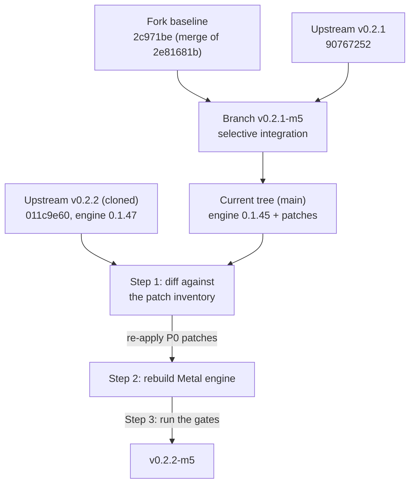

# Strata v0.2.2 M5 Max Migration Report — Apple Silicon M5 Max 128 GB

**Target Hardware:** Apple Silicon Mac (M5 Max, 128 GB Unified Memory; the machine reports 137.4 GB to the OS)
**Operating System:** macOS 27 (Golden Gate)
**From:** Strata `v0.2.1-m5` (working tree `main` = merge of PR #7; fork merge `2c971be` of patch `2e81681b`, upstream baseline `90767252`)
**To:** Strata `v0.2.2` — cloned at `Strata-0.2.2/`, tag `v0.2.2`, commit `011c9e60`. **The 0.2.2 app runs engine 0.1.47** (CMake `project(strata VERSION 0.1.47)`, bump commit `1c9bfd2a`: "app 0.2.2, engine and Control 0.1.47"). The current tree builds engine 0.1.45 plus the local patches.

This report consolidates [v0.2.1-m5-optimizations.md](v0.2.1-m5-optimizations.md),
[strata-v0.2.1-m5-migration.md](strata-v0.2.1-m5-migration.md),
[v0.2.1-m5-RoPE-Swift1.5-Report.md](v0.2.1-m5-RoPE-Swift1.5-Report.md) and
[audits/strata-v0.1.45-vs-v0.2.1-m5-max-audit.md](audits/strata-v0.1.45-vs-v0.2.1-m5-max-audit.md)
into the single working spec for the upgrade. The step-by-step work is in
**[v0.2.2-m5-implementation-plan.md](v0.2.2-m5-implementation-plan.md)**. Every file, test and mechanism listed
here was checked against both trees on the date of writing. Measured numbers say what they were measured on, per
the docs style in [AGENTS.md](../AGENTS.md).

---

## 1. Mission and Method

The M5 Max build is a fork layered on upstream. A version bump is not a checkout — it is **re-applying the local
patchset onto new upstream**, then re-verifying. The v0.2.1 bump proved why: upstream had silently reverted Metal
RoPE scaling and dropped the Apple Mach VM sampling, and a wholesale adoption would have regressed both.



Three steps, in order: **(1)** diff upstream 0.2.2 against the patch inventory in section 3 — do not trust the
merge to carry the local patches; **(2)** rebuild; **(3)** run every gate in section 7 on the M5 Max itself.

---

## 2. Provenance

| Item | Value |
|---|---|
| Fork baseline | `2c971be` (merge of local patch `2e81681b`) |
| Upstream integrated at v0.2.1-m5 | `v0.2.1` (`90767252`), as directory snapshot `Strata-0.2.1/` (deleted from the tree) |
| Current working tree | `main` = `06b683a5`, merge of PR #7 (`v0.2.1-m5`); engine version 0.1.45 |
| Migration target | upstream `v0.2.2` = `011c9e60` (tag `v0.2.2`), cloned at `Strata-0.2.2/`; engine version 0.1.47 |
| Engine delta v0.2.1 → v0.2.2 | 61 commits touching `src/`, `include/`, `metal/` — Gyro trellis kernels (Metal: +5% decode on the Mac, measured on the M5 Max, 5/5 pairs, same output; CUDA: Gyro-S +17% / Gyro-M +11% on an RTX 3060; Pascal ~30%), HIP first-window hang fix, #3465 batched NaN retry, #3480 `GPU_MAX_HW_QUEUES` respect, CPU pool core awareness + `--pool-cores`, `--spec` starts the speculative loop on a 1-token prompt, memory tiers count RAM + VRAM − 5 GB (#3425) |

---

## 3. Patch Inventory — What Must Survive the Merge (P0)

Status column verified against the `Strata-0.2.2/` clone on the date of writing.

| # | Local patch | File(s) | Status in 0.2.2 | Re-verified by |
|---|---|---|---|---|
| P0-1 | GPU-executed Metal RoPE / YaRN scaling (`build_rope_table_interleaved`, `RopeScaling` dispatch) | `metal/src/engine/window.cpp`, `metal/src/engine/rope_table.h` | **Missing — must port.** 0.2.2 has no `rope_table.h` and its `window.cpp` builds the fixed unscaled table. The shared math (`include/strata/kernels/rope_scaling.hpp`) and the host builder in `setup_host.cpp` are present and identical in both trees. See the warning below. | `tools/test_setup_rope.py`, `metal/tests/rope_parity.cpp` (port), `src/kernels/rope_parity.cpp` |
| P0-2 | Apple Mach VM host memory sampling (`sysctlbyname("hw.memsize")`, `host_statistics64`) | `src/core/conversation_memory.cpp` | **Missing — must port.** 0.2.2's `conversation_memory.cpp` has no Apple branch. Note: `src/core/expert_source.cpp` `host_available_memory()` (Mach-based) exists in **both** trees — that half is upstream, not a local patch. | `tools/test_setup_mac.py` |
| P0-3 | Process lifeline supervision | `serve/lifeline.py`, `serve/owner_guard.py`, `serve/ready.py`, `serve/launch_identity.py` | **Present in 0.2.2** (with `test_lifeline.py`). No port; keep on merge. | `serve/test_lifecycle.py`, import check |
| P0-4 | Local API-key authentication (`Authorization: Bearer` / `x-api-key`) | `switch.sh`, `monitor.py` | Verify at merge (upstream `server.py` has its own `_authorized`). | `serve/test_security.py`, script inspection |
| P0-5 | Metal KV cache validation | `src/program/generate.cpp` | Verify at merge. | build + runtime check |

**⚠️ Verified finding — the current tree already lost the RoPE call site.** The v0.2.1-m5 RoPE report claims the
`build_rope_table_interleaved` dispatch is retained in `window.cpp` lines 490–500. It is not: the current tree's
`window.cpp` contains the fixed-table loop (the upstream form), and **nothing in the engine calls
`build_rope_table_interleaved` — only `metal/tests/rope_parity.cpp` does**. The v0.2.1 integration merge kept the
builder (`rope_table.h`, fork commits `1ee7e5d3` / `b5a44fe3`) but took upstream's `window.cpp`. So today, on both
trees, the Metal decode window runs unscaled frequencies for YaRN/linear-scaled configs — the >32,768-token
degradation the audit warned about. The implementation plan wires the dispatch in **both** trees and proves it
with the parity test.

**RoPE detail carried from the RoPE report:** the local path builds the interleaved float2 table host-side (YaRN
ramp + interpolation/extrapolation + mscale) and `qsa.metal` reads the precomputed pairs. Bit-exact to 524,288
tokens, verified by `tools/test_setup_rope.py` on the M5 Max.

---

## 4. Upstream Features — Verified in the 0.2.2 Clone

| # | Feature | File(s) in 0.2.2 | Note |
|---|---|---|---|
| P1-1 | Relocatable Metal resource locator | `metal/src/resource_path.h`, `metal/src/mtl_rt.mm` | Present |
| P1-2 | Multi-stream chunked HTTP Range downloader | `setup.py` | Present |
| P1-3 | M5 Max auto-fit of context and draft layer | `strata_control/mac_fit.py` | **Resolved:** 0.2.2's `metal/setup_mac.py` imports `strata_control.mac_fit` directly — the P1/P3 entanglement from the previous revision of this report is gone; `strata_control/` ships with the clone. |
| P2-1 | Standalone vision tool | `tools/vision/` | Present |
| P3-1 | Desktop control mode | `strata_control/` | Ships upstream; the earlier "defer" applied to the old fork, not to 0.2.2 |

**Swift 1.5 in 0.2.2: fully present, no port needed.** `setup.py` registers `family = "swift"` (UkisAI's
fine-tune), the `SWIFT_FILES` shard pins, `MEMORY_TIERS` includes the 38 GB `(swift, IQ2_XS)` tier,
`RECOMMENDED_SIZES` swift → `IQ3_S`, and the **Q2_0 exclusion guard (#171) is preserved verbatim**. Same
`qwen4exp` engine pipeline (2,560 hidden, 48 layers, MoE).

---

## 5. M5 Max Optimization Registry — All Verified Present in 0.2.2

| Mechanism | 0.2.2 evidence |
|---|---|
| Arena budgeting: `arena_keep()` = `max(7 GB, 0.15 x RAM)`, `arena_budget()`, `footprint_cap()`, `resident_cap()`, `arena_grow()`, `kBigMac` / `kLeaveShare` / `filecache_min` / `arena_ple_reserve` | `metal/src/engine/arena_budget.h`, `window.cpp` `avail_now` lambda, `metal/tests/arena_budget_test.cpp` |
| `recommendedMaxWorkingSetSize` query (~122.8 GB / 96% of RAM on this machine, measured on the M5 Max) | `metal/src/mtl_rt.mm` |
| `coop_k4` runtime probe + M4/M5 tile branches | `window.cpp` (`m5_layout_`, `coop_k4()`), `metal/tests/coop_probe.h`, `coop_layout.cpp` |
| Function constant registry: FC 5 (`MM_PROBE`), FC 7 (`COOP_K4`, **defaults true when undefined**), FC 20 (stream), FC 22 (`MOE_PROBE`), FC 23 (`QUANT_CTAB`, 3–7% faster on M5 Max matrix units, measured on the M5 Max), FC 24 (mrope) | `metal/kernels/quant.metal`, `moe_mm.metal`, `qsa_prompt.metal`, `window.cpp` |
| Streaming decision (measured on the M5 Max): 115.4 GB working set, 96.2 GB resident cap — GSQ packs, IQ3_S and UD-Q4_K_XL stay resident; UD-Q5/Q6_K_XL stream | `metal/src/engine/stream.cpp` |
| Mach sampling in `expert_source.cpp` (upstream half) | `src/core/expert_source.cpp` |
| Lifeline suite | `serve/` (see P0-3) |

**Keep-free numbers:** the formula gives 19.2 GB on the nominal 128 GB, but **the real machine reports 137.4 GB,
so keep is 20.6 GB** (frozen in `arena_budget_test.cpp`: 137.4 GB RAM / 115.4 GB working set / 97.7 GB available).
Do not pin `STRATA_METAL_KEEP_FREE_GB=19.2` — the override would lower the reserve. Leave it unset.

---

## 6. Environment Variable Registry (migration-relevant subset)

Unchanged between the trees (verified). The old guide documented only the first.

| Variable | Default | Purpose |
|---|---|---|
| `STRATA_METAL_KEEP_FREE_GB` | unset (formula) | override the macOS keep-free reserve — see section 5 caveat |
| `STRATA_METAL_ARENA_GB` | unset (formula) | pin the arena size |
| `STRATA_METAL_LEAVE_SHARE` | `kLeaveShare` | big-Mac leave share, for measuring |
| `STRATA_METAL_CTAB` | on | `=0` disables FC 23 (threadgroup copy) |
| `STRATA_METAL_STREAM` | auto | force expert streaming on/off |
| `STRATA_METAL_ARENA_CHUNK_GB` / `STRATA_METAL_ARENA_STEP_GB` | 8 GB / 1.5 GB | arena chunk and growth step |
| `STRATA_METAL_WIRE_ARENA` | on for big Macs | pin the arena |
| `STRATA_METAL_CLASS_WASTE` | 0.15 | class waste tolerance |
| `STRATA_METAL_PROMPT_MIN` / `STRATA_METAL_PROMPT_CHUNK` | 32 / 2048 | prompt-chain rows and chunk |
| `STRATA_METAL_PROMPT_GEMM` | on | `=0` disables |
| `STRATA_METAL_FUSE` | on | `=0` disables QSA score/top-k fusion |
| `STRATA_METAL_PARTIAL` / `STRATA_METAL_ROUTE` | off | measured-slower folds, opt-in (measured on the M5 Max: 0.3–0.8% and 0.3–0.5% slower) |
| `COOP_K4` | probe result | override the layout probe |
| `MM_PROBE` / `MOE_PROBE` / `CHAIN_CTAB` / `QUANT_CTAB` | 0 / 0 / on / off | test-harness knobs only |

---

## 7. Validation Gates for v0.2.2 (run on the M5 Max itself)

**Gate 1 — Python setup tests (no GPU or downloads needed):**

```bash
python3 tools/test_setup_mac.py
python3 tools/test_setup_rope.py
```

**Gate 2 — Metal engine build:**

```bash
python3 metal/setup_mac.py --build --check
```

**Gate 3 — Metal parity and probe tests** (bitwise parity against the reference; run after the build):
`arena_budget_test`, `coop_layout`, `expert_parity`, `moe_mm_parity`, `token_chain`, `prompt_chain`,
`qsa_parity`, `gemv_parity`, `gyro_parity` — sources in `Strata-0.2.2/metal/tests/`. RoPE parity: 0.2.2 keeps it
at `src/kernels/rope_parity.cpp`; the ported `metal/tests/rope_parity.cpp` (from the current tree) must pass
alongside it.

**Gate 4 — Process supervision:** import check on `serve.lifeline`; `serve/test_lifecycle.py`,
`serve/test_lifeline.py`.

**Gate 5 — End-to-end on the M5 Max:**

```bash
STRATA_KEY="test-key-123" ./switch.sh status
python3 tools/strata_bench.py --url http://127.0.0.1:8080 --prompt "Explain quantum mechanics in 50 words." --tokens 100 --runs 5
python3 tools/strata_bench.py --url http://127.0.0.1:8080 --prefill-tokens 8192 --tokens 10 --runs 3
```

Compare gate 5 numbers against a same-day run of the v0.2.1-m5 build on the same machine; a new default is only
accepted where it measures faster, with the numbers shown.

---

## 8. Recommended Configuration for the M5 Max 128 GB

- **Context:** 65,536 tokens (`--max-context 65536`) — within the 108.8 GB nominal working-set cap (115.4 GB
  working set on the real machine; see section 5). `strata_control/mac_fit.py` auto-fits this.
- **Speculative draft layer:** `--spec 2` or `--spec 3` (`--mtp` for MTP-capable models).
- **Keep-free:** leave `STRATA_METAL_KEEP_FREE_GB` **unset** (the formula gives 20.6 GB on the real machine).
- **Quantization:** `IQ3_S` or `UD-Q4_K_XL` (Unsloth repack). `IQ2_XS` / `IQ3_XXS` also fully supported.
- **Swift 1.5** (UkisAI `Swift-1.5-Qwen3.8-Flash-Next-GSQ-RCO-GGUF`, `qwen4exp`, 2,560 hidden, 48 layers):
  supported end-to-end on Metal for `IQ2_XS`, `IQ3_XXS`, `IQ3_S`. **`Q2_0` stays excluded** — its GGUF files split
  one layer's experts across the two shards, which `tools/iq_pack.py` cannot prepare yet (#171); the guard lives
  in `setup.py` and `metal/setup_mac.py`.
- **Vision:** `mmproj-Swift-Qwen3.8-Flash-Next-BF16.gguf` via `tools/vision/`.
- **API exposure:** never beyond `127.0.0.1` without `--api-key`.

---

## 9. Risks and Open Items for the 0.2.2 Merge

1. **RoPE call site (top risk, now verified):** neither tree's `window.cpp` wires the scaling dispatch — the
   current tree lost it at the v0.2.1 merge (section 3 warning). Fix in both trees per the implementation plan;
   until then, treat ">32k context with YaRN" as unverified on both.
2. **The two wholesale-revert files** (`window.cpp`, `conversation_memory.cpp`) must be merged by hand — they are
   where v0.2.1 bit us, and 0.2.2's copies are still the upstream form.
3. **FC 7 default-true semantics:** the kernels default `coop_k4` to true when the constant is undefined. If the
   merge touches function constants, re-run `coop_layout` before trusting the probe.
4. **Frozen test numbers are machine-specific** (137.4 GB / 115.4 GB / 97.7 GB). If arena policy changes, update
   `arena_budget_test.cpp` from a fresh freeze on the M5 Max, not from the nominal 128 GB.
5. **Style debt carried from the v0.2.1 docs:** the 3–7% CTAB gain and the section 8 recommendations should cite
   what they were measured on; this report marks each number it can attribute and flags the rest.

## 10. Rollback

```bash
git checkout main
git branch -D v0.2.2-m5    # the new branch; main (v0.2.1-m5) stays as the known-good baseline
```

Keep `main` intact — it is the known-good baseline the gates compare against.
