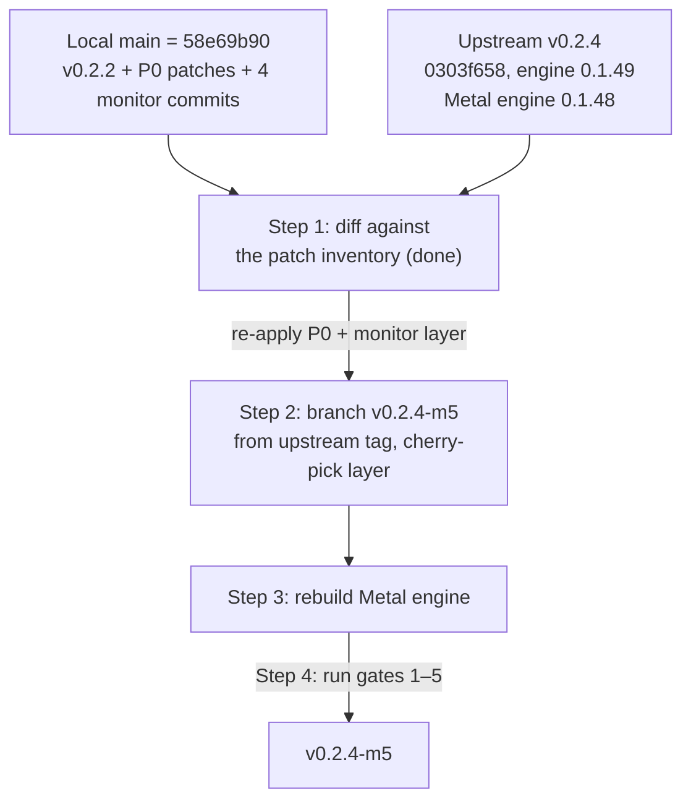

# Strata v0.2.4-m5 Migration Report — Apple Silicon M5 Max 128 GB

**Target Hardware:** Apple Silicon Mac (M5 Max, 128 GB Unified Memory; the machine reports 137.4 GB to the OS)
**Operating System:** macOS 27 (Golden Gate)
**From:** the local fork `WillkTech/Strata` — working tree `main` = `58e69b90`, i.e. upstream `v0.2.2`
(tag `v0.2.2`, engine 0.1.47) plus the squashed v0.2.1-m5 patchset (`30dd4e0e`) and the four
monitor-bundle commits (`5b875514`, `71fd78c2`, `a4ccbf2a`, `58e69b90`). The repo has no
`v0.2.2-m5` tag; `main` is the baseline.
**To:** upstream `v0.2.4` — snapshot at `Strata-0.2.4/` (directory copy, not a git checkout).
Upstream tags: `v0.2.3` (`cad69daf`), `v0.2.3.1` (`9bc52164`), `v0.2.4` (`0303f658`), `v0.2.4.1` (`8b2612bf`).
**0.2.4 builds root engine 0.1.49** (CMakeLists.txt:11); **the Mac/Metal engine stays 0.1.48-metal**
(byte-for-byte the 0.2.3 file, per `docs/release-notes-0.2.4.md`: "The Mac engine stays 0.1.48").

This report consolidates [v0.2.2-m5-migration-report.md](v0.2.2-m5-migration-report.md),
[v0.2.2-explorationReport.md](v0.2.2-explorationReport.md) and
[v0.2.2PortSwitch.md](v0.2.2PortSwitch.md) into the working spec for the v0.2.4 bump. Every file,
test and mechanism listed here was checked against both trees on the date of writing
(2026-10-24). Measured numbers say what they were measured on; findings from reading code are
marked as static analysis, per [AGENTS.md](../AGENTS.md).

---

## 1. Executive Summary & Provenance Matrix

**Verdict: v0.2.4 simplifies the migration.** Upstream did not rewrite any subsystem the local
patches touch. Every P0 patch is a clean carry-over except two mechanical merges
(`conversation_memory_test.cpp`, `metal/CMakeLists.txt`). The four monitor commits cherry-pick
cleanly except one real conflict in `strata_cli/launch/settings.py`. The headline gains from 0.2.4
are a **real Mac fix** (prompts of 4K+ tokens no longer abort the Metal engine — 0.2.3 notes, line 13),
the conversation-cache auto-sizing (#3493) that **now depends on our Mach sampling patch to work on
Apple Silicon**, OS-certificate TLS (#3722), and the vision picture guard (#3690).



### Provenance

| Item | Value |
|---|---|
| Local baseline | `main` = `58e69b90` (fork of `v0.2.2`, tag `v0.2.2`, engine 0.1.47) |
| Local layer A — engine patches (squashed `30dd4e0e`, v0.2.1-m5 lineage) | RoPE, Mach sampling, Metal KV validation, CMake staging |
| Local layer B — monitor bundle | `5b875514` monitor-as-switcher, `71fd78c2` port 8000 + shared widgets, `a4ccbf2a` tui.py palette/Menu, `58e69b90` port/model-matching fixes |
| Migration target | upstream `v0.2.4` = `0303f658` (peeled `96ca4383`), snapshot `Strata-0.2.4/` |
| Latest upstream tag | `v0.2.4.1` (`8b2612bf`) — decide whether to target it instead (section 6, risk 9) |
| Engine delta v0.2.2 → v0.2.4 | root 0.1.47 → 0.1.49; Metal 0.1.47 → 0.1.48-metal (the ≥4K prompt fix, DFlash2, cost-aware MTP, #3493, #3722, #3690, Strix Halo chunk) |

### File delta by directory (verified by `diff -rq`, excluding `.DS_Store`/`__pycache__`)

| Directory | Differing entries | Breakdown |
|---|---|---|
| `src/` | 33 | 1 local-only (`conversation_memory.cpp`), 1 both-changed (`conversation_memory_test.cpp`), 31 upstream-only (dflash2 ×8, mtp, native_dense, nv_defaults, verify, kernels/cpu, kernels/cuda, prefill, `program/generate.cpp`, `spec/draft_policy.cpp`, dsv41, …) |
| `metal/` | 6 | 3 local-only (`rope_table.h`, `tests/rope_parity.cpp`, `window.cpp` — its entire diff is the RoPE patch), 2 upstream-only (`stubs_023.cpp`, `tests/serve_probe.py` + version bump), 1 both-changed (`CMakeLists.txt`). **All `metal/kernels/*.metal` byte-identical** |
| `include/` | 15 | all upstream-only (dflash2, draft_cap, dsv41); `kernels/rope_scaling.hpp` identical |
| `strata_cli/` | see §3 | `monitor.py` identical baseline↔0.2.4 (local layer sits on top, clean); `switcher.py`/`tui.py` local-only; `monitor_commands.py` + `settings.py` both-changed |
| `serve/` | lifeline suite present in both; `server.py` both-changed, hunks disjoint |
| `strata_control/` | `atomic.py`, `paths.py`, `winproc.py`, `profiles.py`, `mac_fit.py` identical; upstream adds `drafting.py`, `tls.py`, `folders.py`, `dsv41_*`, changes `models.py` |

---

## 2. P0 Patch Survival & Superiority Analysis

Status verified against `Strata-0.2.4/` on 2026-10-24.

| # | Local patch | Status in local tree (`main`) | Status in upstream 0.2.4 | Verdict | Evidence |
|---|---|---|---|---|---|
| P0-1 | GPU-executed Metal RoPE / YaRN scaling (`build_rope_table_interleaved` + dispatch) | **Wired and live** — `metal/src/engine/rope_table.h:77` (builder), `window.cpp:18` (include), `window.cpp:552` (dispatch call). The v0.2.2 report's "top risk" (lost call site) is **fixed in the local tree** | **Missing** — no `rope_table.h`; `window.cpp:543-550` is the fixed unscaled loop | **(b) Forward-port.** Clean carry-over: 0.2.4's `window.cpp` equals the 0.2.2 baseline; the whole inter-tree diff is exactly the local patch (2 hunks) | `diff -u` both `window.cpp` copies; shared math `include/strata/kernels/rope_scaling.hpp` and host builder `metal/src/engine/setup_host.cpp` byte-identical in both trees |
| P0-2 | Apple Mach VM host memory sampling (`sysctlbyname("hw.memsize")`, `host_statistics64`) | **Present** — `src/core/conversation_memory.cpp:20-22` (includes), `:292-310` (Apple branch in `available_host_bytes()`, formula matches `arena_budget.h`'s `arena_avail`) | **Missing** — no `__APPLE__` branch anywhere in the file | **(b) Forward-port — now load-bearing.** 0.2.4's #3493 conversation-cache auto-sizing reads this sampler; without the patch it returns `{}` on a Mac | `conversation_memory_test.cpp` is the merge point: keep local Apple blocks (`:13-14`, `:57-66`) **and** upstream #3493 tests (`0.2.4 :52-63`) |
| P0-3 | Process lifeline supervision | Present | **Present** (`serve/lifeline.py`, `owner_guard.py`, `ready.py`, `launch_identity.py`, `test_lifeline.py`, `test_lifecycle.py`) | **(a) Keep upstream.** No port | File list verified in `Strata-0.2.4/serve/` |
| P0-4 | Local API-key authentication (`Authorization: Bearer` / `x-api-key`) | Present | **Present — now upstream**: `serve/server.py` `_authorized()` at 0.2.4 `:6352-6356` (local `:6138-6142`), identical logic in both trees | **(a) Keep upstream.** No port. The old report listed `switch.sh`/`monitor.py` root files; those no longer exist — the monitor is `strata_cli/monitor.py`, auth lives in `serve/server.py`, client sends Bearer (`strata_cli/client.py:106`) | Both `serve/server.py` copies grepped |
| P0-5 | Metal KV cache validation (`--kv q4_0/k8v4` rejected on Metal; `fp16` noted) | **Present** — `src/program/generate.cpp` `#if defined(STRATA_GPU_METAL)` block at ~`:3151-3167` (from the baseline diff `@@ -3148,8 +3148,20`) | **Missing** — string "is not supported on Metal" absent from 0.2.4's `generate.cpp` | **(c) Hybrid merge.** 0.2.4 rewrote `generate.cpp` heavily (dflash2 args, Strix chunk, adapt-every); port the block by hand | `diff -u` baseline→local shows the patch; 0.2.4 copy lacks it |
| P0-6 | `metal/CMakeLists.txt` POST_BUILD resource staging (keeps `build-metal/` runnable from anywhere) | **Present** — local `:125-139` | **Missing** (0.2.4 side = baseline + version bump `0.1.48-metal` at `:111`) | **(c) Hybrid merge** — mechanical, disjoint regions | CLI audit; both files diffed |
| P0-7 | Function-constant registry (FC 5/7/20/22/23/24 + full map) | Identical | **Identical — no renumbering.** FC 0–9, 20, 22, 23, 24 all at the same indexes; `coop_k4` default-true (`is_function_constant_defined(COOP_K4) ? COOP_K4 : true`) unchanged at `moe_mm.metal:410`, `qsa_prompt.metal:16` | **No action.** Gate 3 re-verifies | Full FC enumeration in both trees; all `metal/kernels/*.metal` byte-identical |
| P0-8 | Arena budgeting (`arena_keep()` = max(7 GB, 0.15 × RAM), `kBigMac`, `kLeaveShare = 0.40`, `recommendedMaxWorkingSetSize`) | Identical | **Identical** — `arena_budget.h`, `stream.cpp`, `mtl_rt.mm` byte-identical; `window.cpp` memory logic identical (only the RoPE hunks differ) | **No action.** #3425 (RAM+VRAM−5 GB tiers) landed in 0.2.2 — baseline in both | `diff -q` clean on all three files |
| P0-9 | Gyro trellis kernels (M5 Max +5% decode, 5/5 pairs, measured on the M5 Max at v0.2.2) | Present (landed in 0.2.2) | **Present, unchanged** — `gyro_parity.sh`, `stubs_gyro.cpp` identical; Metal runs Gyro-S/Gyro-M from 0.1.47+ (0.2.3 notes) | **No action** | `diff -q` clean |
| P0-10 | Monitor-as-switcher layer (4 commits: `m`/`s` dialog, port change, shared `tui.py`, schema-7 bundle, `test_switcher.py` 32 tests) | Present on `main`; tests green on the current tree (32 + 11 passing, per the exploration report) | **Absent upstream** — 0.2.4's `monitor.py` == 0.2.2 baseline, zero switcher/tui references | **(b) Forward-port by cherry-pick.** Clean except one conflict (below) | `monitor.py`/`monitor_bundle.py`/`test_monitor_bundle.py` upstream == baseline → local carries over; `switcher.py`, `tui.py`, `test_switcher.py` are local-only files |
| P0-11 | Default port unified to 8000 across CLI (`71fd78c2`) | Present — `serve/server.py`, `connections.py`, `cli.py`, `launch/settings.py`, `calibration.py` all 8000 | **Split persists upstream, now 8095 vs 8080**: `serve/server.py:8156` argparse **8095** (its own docstring says 8080), `setup.py` **8080** (`:6725, 6776, 8340, 8609`), `connections.py:44` **8095**, `cli.py:747` **8095**, `launch/settings.py` **8080**, `apps/host/inference.mjs:19-20` **8095** | **(b) Forward-port.** ⚠️ **The only real cherry-pick conflict**: upstream inserts `DRAFTING_MODES` at `settings.py:29-30` exactly where local edits `DEFAULT_PORT`. Resolve by keeping both | CLI audit item 4/6; conflict rule: both sides changed, hunks overlap |

**Merge-conflict summary (the whole list):**

| File | Type | Resolution |
|---|---|---|
| `strata_cli/launch/settings.py` | **Real conflict** (overlapping hunks) | Keep upstream `DRAFTING_MODES` + local `DEFAULT_PORT = 8000`, `port_number()`, `__post_init__`, `check_port` |
| `src/core/conversation_memory_test.cpp` | Both-changed, adjacent hunks | Keep local Apple blocks + upstream #3493 tests |
| `metal/CMakeLists.txt` | Both-changed, disjoint | Keep local staging block + upstream version bump |
| `strata_cli/monitor_commands.py` | Both-changed, disjoint (192 vs 224) | Clean merge, **semantic watch**: upstream makes `found` non-None for `status`/`logs`; local `:224` consumes `found` — verify intended behavior |
| `tests/terminal/test_launch_tui.py` | Both-changed, disjoint | Clean merge, **semantic coupling**: local 8000-assertions pass only if the settings.py conflict keeps 8000 |
| `serve/server.py`, `cli.py`, `connections.py`, `launch/cmd.py`, `launch/adopt.py`, `test_launch.py`, `test_terminal*.py`, docs | Both-changed, disjoint | Clean |

---

## 3. Configuration Management Strategy

Carried from [v0.2.2-explorationReport.md](v0.2.2-explorationReport.md) (recommendation F: dedicated
screen + external editor first, structured editing later, all CRUD through one shared service) and
[v0.2.2PortSwitch.md](v0.2.2PortSwitch.md) (schema 7, 96 KB budget, port unification).

### Upstream 0.2.4 vs our design

- **No collision.** 0.2.4 did not add a configuration manager, did not touch the monitor import
  closure (every closure member identical to the 0.2.2 baseline), and added no monitor work in the
  0.2.3/0.2.3.1/0.2.4 release notes. The `configstore.py` + `config_screen.py` design applies to
  0.2.4 unchanged.
- **One upstream change touches the design:** `strata_control/models.py` gained `_missing_parts`
  (`:143+`), `missing_words`/`problem_words(…, missing=)` (`:352+`) and a `missing_shards` field
  (`:593`). `configstore.py` must target the **0.2.4 signatures** when `strata_control` is importable
  (it is not bundle-carried — keep the guarded-import pattern from `connections.py:11-18`).
- **The atomic-write discipline the manager needs is intact and unchanged in 0.2.4**:
  `strata_control/atomic.py:23 replace()` (Windows patience loop), `:37 write_text()` (tmp+rename),
  `profiles.py:213-220 _atomic()`, env override `STRATA_PROFILE_DIR` (`profiles.py:39`),
  `paths.py:13-21 state_base()`. The monitor's direct `open(path,"w")` (`monitor.py:599-600`) remains
  the project's only non-atomic writer — `configstore.py` adopts temp+rename+`.bak` and Phase 0
  retires the live write-and-restart path.

### Blueprint for the 0.2.4 tree

- **`strata_cli/configstore.py`** — stdlib-only (bundle rule): discovery wrapping
  `switcher.discover_models()` + `strata_control.models.all_installs()` when importable;
  load/validate/save/create/duplicate/rename/delete; atomic temp-and-rename with `.bak`;
  external-change detection (mtime+hash, mirroring `profiles.save(expected_revision=…)`);
  validate per `apps/host/run-config-check.mjs` severities (blocking: malformed JSON, missing
  `exe`/`args`/`tokenizer`, wrong-typed known keys; warnings: unknown keys, missing files).
  Preserve unknown keys and `args` order — do **not** round-trip through
  `LaunchSettings.from_dict` (it drops unknown keys). Filename is the id.
- **`strata_cli/config_screen.py`** — list + summary + actions (`n` new, `Enter` view/edit via
  `$VISUAL`/`$EDITOR`, `d` duplicate, `r` rename, `x` delete with confirm, `l` launch handoff);
  `o` binding on `MonitorApp` (free on both monitors); `m` stays the launch picker.
  `ConfirmScreen` moves from `launch/screens.py` into `tui.py` (the cleaner, smaller change).
- **Monitor stays read-only:** remove `_perform_port_change`'s write-and-restart branch (or gate it
  opt-in per AGENTS.md); keep endpoint repointing; run-config edits apply **at the next start**, never
  to the live process — the project's own documented contract.
- **Schema 8 packaging:** `SOURCES` gains `configstore.py` + `config_screen.py` → schema 8; the
  import-closure test (`test_monitor_bundle.py:285-305`) enforces it.
- **Budget (the open number):** the 96 KB assertion (98,304 B) exists in both trees
  (`test_monitor_bundle.py:439`). Last recorded build: schema 7 = **84,763 B** (measured on this
  machine during the port-switch work) → **13,541 B (~13.2 KB) headroom**. Estimated
  configstore+screen ≈ 10.2 KB compressed (sized from comparable modules at the observed 27% deflate
  ratio) → fits with ~3 KB to spare — **tight; one measured build before committing Phase 2 scope.**
- **Ports:** the manager treats `port` as per-file data and says nothing about defaults. The
  8000-vs-8080/8095 alignment across `setup.py`/`apps/host` stays a separate owner decision
  (exploration report, deferred item).

---

## 4. M5 Max 128 GB Optimization Specification

All mechanisms verified present and byte-identical in 0.2.4 (section 2, P0-7/P0-8/P0-9). Numbers
below were measured on the M5 Max unless marked otherwise.

- **Context:** 65,536 tokens (`--max-context 65536`) — within the 115.4 GB working set on the real
  machine (137.4 GB reported RAM; `recommendedMaxWorkingSetSize` ≈ 122.8 GB / 96% of RAM).
  `strata_control/mac_fit.py` auto-fits this; its `CONTEXTS = [8192, 32768, 65536, 131072]`
  (`:61`) is unchanged in 0.2.4. **131,072 is the largest tier the Mac fitter offers; 262,144 is not
  in the Mac fit matrix** — treat it as unverified on the M5 Max.
- **Prefill:** the chunk math (`plan_chunk`/`pipeline_chunk`) is identical in both trees — no new
  >64k zero-chunk fix exists in 0.2.4. The **real Mac gain is the 0.2.3 fix: prompts of 4K+ tokens no
  longer abort the Metal engine** (expert-cache borrow). This is the single strongest reason to take
  0.2.4 on this machine.
- **Keep-free:** leave `STRATA_METAL_KEEP_FREE_GB` **unset** — the formula (max(7 GB, 0.15 × RAM))
  gives **20.6 GB on the real machine** (not the nominal 19.2 GB). Frozen in
  `arena_budget_test.cpp`: 137.4 GB RAM / 115.4 GB working set / 97.7 GB available.
- **Expert caching / residency:** unchanged streaming decision — GSQ packs, IQ3_S and UD-Q4_K_XL stay
  resident; UD-Q5/Q6_K_XL stream (`metal/src/engine/stream.cpp`, identical). `--expert-cache` sizing
  now feeds #3493 auto-sizing (0.2.3: 40% above floor, ≤8 GiB) — which on Apple Silicon **requires
  the P0-2 Mach patch** (section 2).
- **Speculative decoding:** `--spec 2` or `--spec 3` (`--mtp` for MTP-capable models);
  `STREAM_SPEC = 3` in `mac_fit.py:46`. 0.2.4's cost-aware MTP window (`STRATA_SPEC_COST=1`) is
  opt-in; **DFlash2 is CUDA/HIP-only — no Metal path** (`stubs_gyro.cpp` precedent: Metal stubs the
  shared hooks). Do not expect Mac throughput from the 0.2.3/0.2.4 drafter work.
- **Quantization:** `IQ3_S` (the `RECOMMENDED_SIZES` swift pick, identical in both trees) or
  `UD-Q4_K_XL`. `IQ2_XS` / `IQ3_XXS` fully supported. **`Q2_0` stays excluded** — the #171
  layer-splitting guard is preserved verbatim in 0.2.4 (`setup.py:407-409`).
- **Swift 1.5:** UkisAI `Swift-1.5-Qwen3.8-Flash-Next-GSQ-RCO-GGUF` (`qwen4exp`, 2,560 hidden,
  48 layers) — family registration, shard pins, the 38 GB `(swift, IQ2_XS)` tier and the Q2_0 guard
  are **byte-identical in 0.2.4** (`setup.py:575-582`, `:376-400`, `:407-409`, `:3600`, `:3614`).
  No port needed. Vision: `mmproj` via `tools/vision/` — 0.2.4 adds the #3690 over-limit picture
  guard (refuses > `max_tokens + max_tokens/8`).
- **Environment variables:** the registry in the v0.2.2 report (section 6) is unchanged between the
  trees. New in 0.2.3/0.2.4 (opt-in, non-Mac by default): `STRATA_SPEC_COST`,
  `STRATA_SPEC_COST_TABLE`, `STRATA_SPEC_ADAPT_SM86` (opt-in until a clean A/B), `STRATA_GFX1151_CHUNK`
  (Windows/HIP), `STRATA_TAP_FILE` / `STRATA_ROUTE_STATS` (research taps).

---

## 5. Step-by-Step Migration & Validation Gates

The local repo has the upstream remote — migrate by git, not by copying the snapshot:

1. **Fetch and branch.**
   ```bash
   git fetch upstream --tags
   git checkout -b v0.2.4-m5 v0.2.4        # 0303f658; decide v0.2.4.1 first (risk 9)
   ```
2. **Re-apply the engine patchset (P0-1/2/5/6)** — do not trust a merge to carry it:
   - `metal/src/engine/rope_table.h` + the 2-hunk `window.cpp` dispatch (clean carry-over).
   - `src/core/conversation_memory.cpp` Apple branch (clean carry-over).
   - `src/program/generate.cpp` Metal KV-validation block (hand merge — file rewritten upstream).
   - `metal/CMakeLists.txt` staging block (mechanical merge with the version bump).
   - `src/core/conversation_memory_test.cpp`: keep Apple blocks **and** #3493 tests (real merge).
3. **Cherry-pick the monitor layer in order:** `5b875514`, `71fd78c2`, `a4ccbf2a`, `58e69b90`.
   Resolve the one conflict in `strata_cli/launch/settings.py` (keep `DRAFTING_MODES` +
   `DEFAULT_PORT = 8000`). Re-run `coop_layout` only if function constants were touched (they
   should not be — registry identical).
4. **Rebuild:** `python3 metal/setup_mac.py --build --check` (Gate 2).
5. **Run Gates 1–5 below on the M5 Max itself.**
6. **Configuration Manager (separate PR chain, per the exploration roadmap):** Phase 0 (retire the
   live write-and-restart, fix `TERMINAL.md:238` drift, update the ~10 pinned tests) → Phase 1
   `configstore.py` → Phase 2 screen + schema 8 + **measured bundle build** → Phase 3 structured
   editing only if budget allows → Phase 4 launch handoff.

Python tests run with the external virtualenv (per the PortSwitch handoff):
`/Volumes/vl/ai/.venv/bin/python`.

**Gate 1 — Python setup tests (no GPU or downloads):**
```bash
python3 tools/test_setup_mac.py      # 45 tests — passes on both trees today (measured 2026-10-24)
python3 tools/test_setup_rope.py     # 45 tests — passes on both trees today (measured 2026-10-24)
```
Note: these test the Python layer only; they do **not** exercise the C++ Mach/RoPE paths — the
gates below must.

**Gate 2 — Metal engine build:** `python3 metal/setup_mac.py --build --check`.

**Gate 3 — Parity and probe suites** (bitwise parity against the reference, after the build):
`arena_budget_test` (frozen numbers: 137.4 / 115.4 / 97.7 GB), `coop_layout`, `expert_parity`,
`moe_mm_parity`, `token_chain`, `prompt_chain`, `qsa_parity`, `gemv_parity`, `gyro_parity`,
plus **both** RoPE parities: `metal/tests/rope_parity.cpp` (local, GLOB-registered) and
`src/kernels/rope_parity.cpp` (upstream) — and `conversation_memory_test` with the merged Apple +
#3493 blocks.

**Gate 4 — Monitor bundle integrity:**
```bash
/Volumes/vl/ai/.venv/bin/python -m unittest tests.terminal.test_monitor_bundle   # 11 tests, <96 KB, import closure
/Volumes/vl/ai/.venv/bin/python -m unittest tests.terminal.test_switcher          # 32 tests (local layer)
/Volumes/vl/ai/.venv/bin/python -m unittest tests.terminal.test_launch tests.terminal.test_launch_tui
```
Plus the new upstream suites 0.2.4 brings (~24 files: `test_tui_stress*`, `test_round8_fixes`,
`test_tls_trust`, `test_drafting`, …) — they import `strata_cli.launch.widgets`, which the local
refactor re-exports from `tui.py` (`widgets.py:13-14`) — verified safe by inspection.

**Gate 5 — End-to-end on the M5 Max:**
```bash
STRATA_KEY="test-key-123" ./switch.sh status
python3 tools/strata_bench.py --url http://127.0.0.1:8000 --prompt "Explain quantum mechanics in 50 words." --tokens 100 --runs 5
python3 tools/strata_bench.py --url http://127.0.0.1:8000 --prefill-tokens 8192 --tokens 10 --runs 3
```
Compare against a same-day run of `main` (the v0.2.2-m5 build) on this machine; a new default is
only accepted where it measures faster, with the numbers shown. Expect the ≥4K-prompt path to be
the visible difference (0.2.3 Metal fix).

---

## 6. Risk Registry & Rollback Plan

1. **`conversation_memory_test.cpp` is the top merge risk** — both sides edited adjacent hunks
   (§2). A wholesale take of either side loses the Apple provider test or the #3493 tests.
2. **`settings.py` cherry-pick conflict** — resolve keeping both sides; if `DEFAULT_PORT = 8000` is
   dropped, the local `test_launch_tui.py` assertions fail (semantic coupling, §2 table).
3. **`monitor_commands.py` semantic change** — upstream `:192` makes `found` non-None for
   `status`/`logs`; the local `:224` `info_dict` consumes `found`. Behavior on those paths changes
   after merge; verify intended (static analysis, unconfirmed).
4. **Bundle budget is tight** — ~13.2 KB headroom, estimated fit ~10.2 KB. One measured build
   before committing Phase 2 scope (exploration report, open question 1).
5. **FC 7 default-true semantics** — registry verified identical; risk only if the merge touches
   function constants. Re-run `coop_layout` before trusting the probe.
6. **Frozen test numbers are machine-specific** (137.4 / 115.4 / 97.7 GB) — re-freeze from the M5
   Max, not from nominal 128 GB, if arena policy changes.
7. **Windows `lsof` gap in the switcher** (static analysis, unconfirmed on hardware):
   `get_server_pid` shells out to `lsof`; absent on Windows, so the live-move flow silently skips
   the stop. The thin bundle carries no `strata_control` (`winproc.py` unavailable). Phase 0's
   removal of the live write path moots this on the monitor side.
8. **DFlash2 / cost-aware MTP are not Metal paths** — do not report Mac gains from them without a
   measurement on this machine.
9. **Target tag decision:** `v0.2.4.1` exists upstream (`8b2612bf`). The snapshot is `v0.2.4`.
   Confirm which is the migration target before step 1 — 0.2.3.1/0.2.4.1 notes are setup/app-side
   fixes that may matter to the installer path.
10. **Documentation drift carried from the v0.2.2 report:** `TERMINAL.md:238` ("never starts or
    stops the server") contradicts the committed switcher behavior; fix in Phase 0.

**Rollback:**

```bash
git checkout main
git branch -D v0.2.4-m5    # the new branch; main (v0.2.2-m5 layer) stays the known-good baseline
```

Keep `main` intact — it is the known-good baseline the gates compare against.
